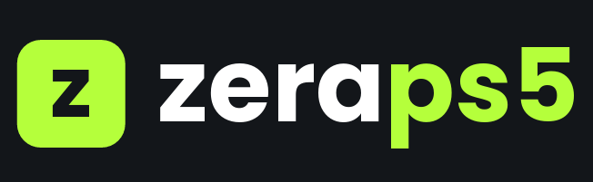

# ZeraPS5 — experimental releases

  
  &nbsp;
  

*Windows application ZIP downloads for the latest release, including updates and tests; not unique users. Updated automatically on an hourly schedule and after a release. GitHub may delay refreshes or cache the image.*

## Download and run

**Current release: v0.1.1-b984.**

**Modern Vulkan paths, flexible internal resolution and stronger runtime compatibility.** See the [b984 release notes](https://github.com/zeraps5/ZeraPS5-Releases/releases/tag/v0.1.1-b984) for technical changes, dated game tests and known limitations.

Highlights included in this release:

- Use modern Vulkan rendering, state and synchronization paths when supported, with compatibility fallbacks.
- Choose Game default, 1440p, 1080p, 900p, 720p or 540p globally or per game for supported Unreal titles, Sonic Origins Plus and TMNT: Splintered Fate.
- Improve native memory mapping and thread/fiber ownership; add optional guest-instruction compatibility for older CPUs.
- Reuse relocated shader translations, optimize large CPU fills and reduce the Videodec2 queue reservation.
- Expand F10 host diagnostics, Sonic Origins save/display handling and optional native input; preserve 15 interface languages and the integrated update/reporting launcher.

**New recorded gameplay:** Sonic Origins Plus reaches Green Hill Zone on Intel Iris Xe (about 23 FPS at 1080p; 35–38 FPS in the dated 720p internal-resolution follow-up). Sonic Superstars reaches Bridge Island (about 15–16 FPS on Iris Xe). Quake II reaches Outer Base with movement and firing (31–53 FPS, median 43 in the final active window on RTX 5060 Ti, b981). These are measured development scenes, not universal performance promises; the compatibility list retains each actual tested revision and configuration.

- [Latest release, downloads, and release notes](https://github.com/zeraps5/ZeraPS5-Releases/releases/latest)
- [Download for Windows x64 — build 984](https://github.com/zeraps5/ZeraPS5-Releases/releases/download/v0.1.1-b984/ZeraPS5-v0.1.1-b984-win64.zip)
- [Download source code — build 984](https://github.com/zeraps5/ZeraPS5-Releases/releases/download/v0.1.1-b984/ZeraPS5-v0.1.1-b984-win64-source.zip)

1. Download the application ZIP above, rather than GitHub’s automatic source archive.
2. Extract the ZIP to a short, writable folder (for example, `C:\ZeraPS5`) and open **ZeraPS5.exe**. Very long paths can exceed Windows extraction limits during updates.
3. Read the included instructions, then add your own games and required console libraries.

## Game compatibility

**b984 is published.** [Detailed changes and reviewed validation](docs/release-candidate-b984.md). The original public b898 launcher downloaded b984 directly from GitHub using its built-in production endpoint and installed the verified ZIP. The updated launcher opened normally and a second check reported the latest version. All 48 payload files, five synthetic user-data markers, previous executable backups and the committed journal were verified in an isolated installation.

[Game compatibility and tested builds](COMPATIBILITY.md) — reviewed 15 November 2026, with dated Intel/RTX development and candidate results, each title's actual tested revision, and the preserved startup survey/history.

[Technical changelog](CHANGELOG.md) · [Contribute or report a result](CONTRIBUTING.md) · [Matching source revision and checksums](SOURCE-VERSION.txt)

Public distribution maintained by **Metallrock (metallrockdev)**.

This repository hosts packaged releases and their corresponding source code.
GitHub’s automatically generated “Source code” archives do not replace the versioned
`*-source.zip` asset or the `sources/` materials included in the application package.

## Experimental software

ZeraPS5 is experimental. Compatibility, stability, and FPS are not guaranteed.
Games, firmware, keys, and console modules are not included in the packages.
Read `LEIA-ME.txt`, `docs/LIMITACOES.txt`, and `docs/RECOMPILAR.txt` inside the ZIP.

## Licensing and credits

See [LICENSE](LICENSE) and [CREDITS.txt](CREDITS.txt). Packages include component licenses,
corresponding source code, FFmpeg sources, and object files for relinking.
Private development is kept separate from this distribution repository.
ZeraPS5 is not affiliated with Sony.
