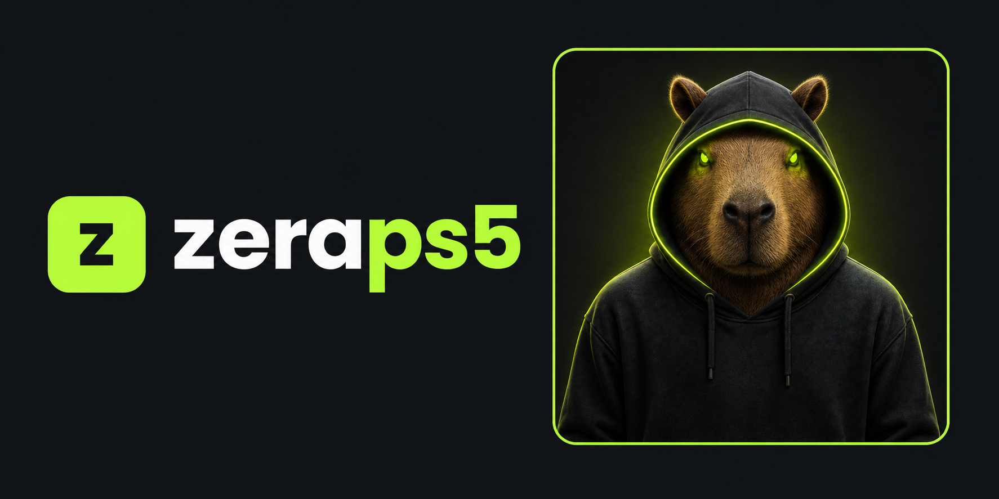

# ZeraPS5 — experimental releases

  

*Windows application ZIP downloads for the latest release, including updates and tests; not unique users. Updated automatically on an hourly schedule and after a release. GitHub may delay refreshes or cache the image.*

## Download and run

**Current release: v0.1.0-b705.**

**Wolverine & ASTRO BOT development milestones, graphics fixes and 2D progress on Intel Iris Xe.** See the [technical changelog and release notes](https://github.com/zeraps5/ZeraPS5-Releases/releases/tag/v0.1.0-b705). The compatibility list keeps the actual tested builds and hardware for these development results.

- [Latest release, downloads, and release notes](https://github.com/zeraps5/ZeraPS5-Releases/releases/latest)
- [Download for Windows x64 — build 705](https://github.com/zeraps5/ZeraPS5-Releases/releases/download/v0.1.0-b705/ZeraPS5-v0.1.0-b705-win64.zip)
- [Download source code — build 705](https://github.com/zeraps5/ZeraPS5-Releases/releases/download/v0.1.0-b705/ZeraPS5-v0.1.0-b705-win64-source.zip)

1. Download the application ZIP above, rather than GitHub’s automatic source archive.
2. Extract the ZIP to a short, writable folder (for example, `C:\ZeraPS5`) and open **ZeraPS5.exe**. Very long paths can exceed Windows extraction limits during updates.
3. Read the included instructions, then add your own games and required console libraries.

## Game compatibility

[Game compatibility and tested builds](COMPATIBILITY.md) — see the latest recorded test for each game, the result reached, and earlier progress where relevant.

Public distribution maintained by **Metallrock (metallrockdev)**.

This repository hosts packaged releases and their corresponding source code.
GitHub’s automatically generated “Source code” archives do not replace the versioned
`*-source.zip` asset or the `sources/` materials included in the application package.

## Experimental software

ZeraPS5 is experimental. Compatibility, stability, and FPS are not guaranteed.
Games, firmware, keys, and console modules are not included in the packages.
Read `LEIA-ME.txt`, `docs/LIMITACOES.txt`, and `docs/RECOMPILAR.txt` inside the ZIP.

## Licensing and credits

See [LICENSE](LICENSE) and [CREDITS.txt](CREDITS.txt). Packages include component licenses,
corresponding source code, FFmpeg sources, and object files for relinking.
Private development is kept separate from this distribution repository.
ZeraPS5 is not affiliated with Sony.

